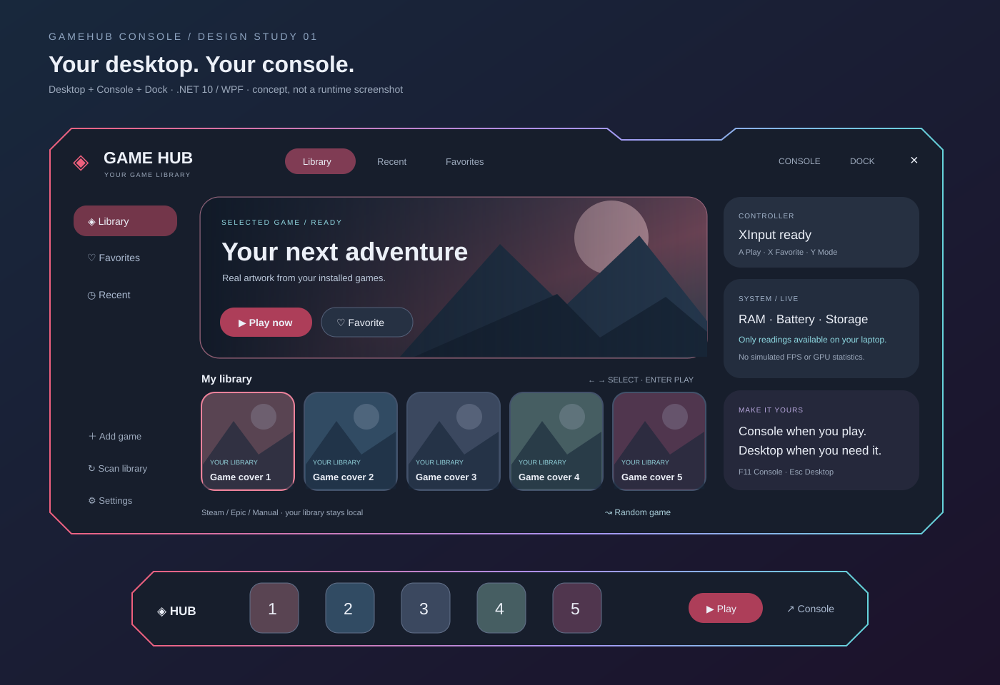

# GameHub Console

Launcher Windows dengan pengalaman seperti konsol. Dibangun memakai **C# / .NET 10 LTS dan WPF**. Tidak memerlukan Windhawk.

> Versi 0.1 adalah fondasi aplikasi yang bisa dibangun, bukan produk final. Tampilan mengadaptasi referensi pengguna: shell gelap dengan sudut terpotong, aksen merah/cyan/ungu tipis, hero game, cover library, dan dock. Tidak memakai logo atau ilustrasi dari referensi.



## Fitur versi awal

- **Console**: tampilan dimaksimalkan, pemilihan game lewat keyboard dan controller XInput.
- **Desktop**: jendela launcher yang dapat digeser dan diubah ukurannya.
- **Dock**: bar ringkas; pilih cover lalu Play, atau klik ganda cover.
- Auto-discovery Steam (termasuk library di drive lain) dan Epic Games.
- Tambah file `.exe`, `.lnk`, atau `.url` secara manual.
- Favorit, recent, pencarian, pemilihan acak, dan penyimpanan lokal.
- Cover/banner dari cache Steam lokal jika tersedia; fallback visual saat artwork tidak ada.
- Pilih artwork sendiri lewat Settings; gambar tidak diunggah ke server.
- RAM, sumber daya/baterai, ruang kosong drive sistem, dan koneksi controller yang dibaca dari Windows.
- Always on top dan opsi membuka mode Console saat login Windows. Startup **mati secara default**.

## Menjalankan

Windows 10/11 x64. Unduh artifact **GameHub-win-x64** dari tab **Actions** setelah build berhasil, ekstrak seluruh ZIP, lalu jalankan `GameHub.exe`. Build portable self-contained sudah membawa runtime .NET. Aplikasi belum ditandatangani digital.

Di laptop, buka **Settings → Open Console at Windows login** jika ingin langsung masuk launcher setelah login. Menutup aplikasi mengembalikan penggunaan Windows biasa; launcher tidak mengganti Explorer.

### Kontrol

| Input | Aksi |
| --- | --- |
| Panah / D-pad / stik kiri | Pilih game |
| Enter / A | Main |
| X controller | Favorit |
| LB / RB | Ganti Library, Favorites, Recent |
| Y controller | Desktop → Console → Dock |
| Start / F11 | Console / Desktop |
| B / Esc | Mode Desktop |
| Ctrl+F | Cari game |

Controller ditangani hanya saat launcher aktif agar tidak merebut input game. Controller Xbox/XInput didukung; DualSense/Switch perlu pemetaan XInput dari Steam Input atau alat lain. Tab dan mouse tetap dapat dipakai. Tombol Random memilih game; tekan Play untuk menjalankannya.

## Build dari source

Pasang SDK .NET **10.0.403** atau patch yang cocok dengan `global.json`.

```powershell
dotnet build GameHub.sln -c Release
dotnet run --project tests/GameHub.Checks -c Release
dotnet run --project src/GameHub.App -c Release
```

Portable Windows x64:

```powershell
dotnet publish src/GameHub.App -c Release -r win-x64 --self-contained true -o artifacts/GameHub-win-x64
```

Workflow GitHub menjalankan checks, build WPF di Windows, dan menyimpan artifact portable. Build otomatis tidak memvalidasi penampilan UI atau perangkat controller fisik; gunakan [checklist Windows](docs/validation.md).

## Data lokal

`%LOCALAPPDATA%\GameHub\library.json` menyimpan library, favorit, recent, mode, dan topmost. File yang tidak dapat dibaca dipertahankan; aplikasi memberi peringatan dan menahan penyimpanan agar data lama tidak tertimpa. Buka folder melalui Settings untuk pemulihan.

Tidak ada telemetry, akun launcher tambahan, atau pengunggahan library. Game diluncurkan melalui protokol resmi Steam/Epic atau file yang dipilih pengguna. Steam/Epic tetap mengelola instalasi, autentikasi, update dan cloud save.

## Batas versi 0.1

- Auto-scan shortcut Desktop/Start Menu, Xbox/UWP, GOG dan Battle.net belum tersedia. Tambahkan shortcut secara manual.
- Cache Steam format/nama baru yang hanya berupa hash atau WebP belum selalu dikenali.
- Scan belum membaca cover Epic secara otomatis.
- Tidak ada statistik FPS/GPU palsu, downloads manager, cloud-save manager, atau remote download artwork.
- Mode Console memakai jendela maksimal; bukan pengganti shell Windows atau exclusive fullscreen.
- Posisi/ukuran, pengaturan monitor, rename game, tray, dan pemulihan fokus setelah game keluar masih roadmap.
- Belum ada installer, code signing, auto-update, dan pengujian hardware menyeluruh.

Lihat [rancangan](docs/design.md), [arsitektur](docs/architecture.md), dan [roadmap](docs/roadmap.md).
