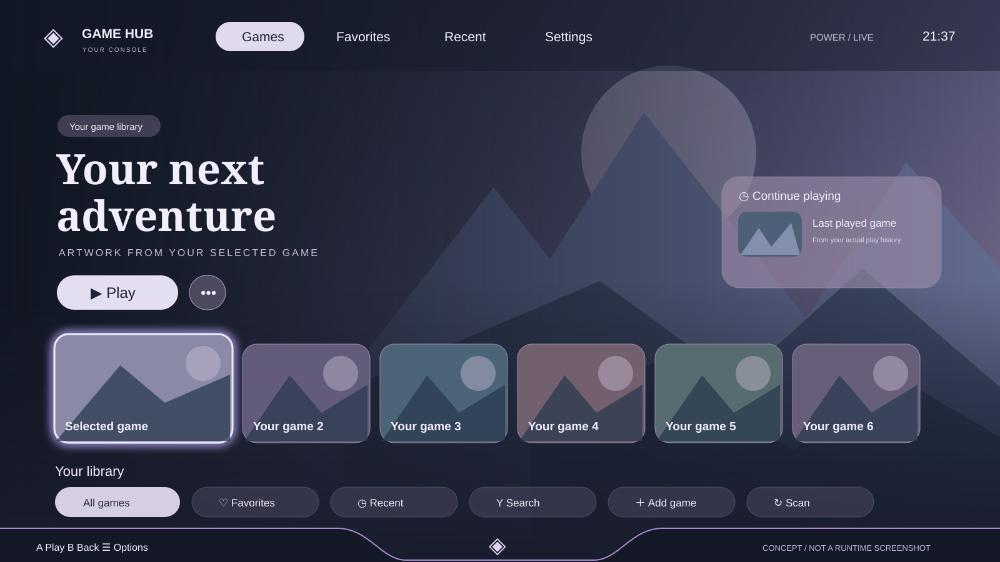

# GameHub Console

Launcher Windows dengan pengalaman seperti konsol. Dibangun memakai **C# / .NET 10 LTS dan WPF**. Tidak memerlukan Windhawk.

> Versi 0.2 menambahkan sesi console shell, tampilan fullscreen, menu controller, dan artwork online. Penggantian shell belum diuji dalam sesi Winlogon nyata; baca prosedur pemulihan sebelum aktivasi. Mode Console mengikuti referensi terbaru: artwork penuh layar, judul besar, kartu game landscape, tab pill dan glow lavender lembut. Mode Desktop/Dock tetap tersedia. Tidak memakai logo atau ilustrasi dari referensi.



[Rancangan Desktop/Dock](docs/concept.svg)

## Fitur versi 0.2

- **Console**: fullscreen monitor, artwork menjadi latar, judul besar di kiri, pilihan game landscape dan tab pill; menyesuaikan referensi console terbaru.
- **Custom user shell**: opsi terpisah menggantikan Explorer untuk akun pengguna pada login berikutnya, dengan guardian dan recovery. [Panduan shell](docs/console-session.md).
- **Desktop**: jendela launcher yang dapat digeser dan diubah ukurannya.
- **Dock**: bar ringkas; pilih cover lalu Play, atau klik ganda cover.
- Auto-discovery Steam (termasuk library di drive lain) dan Epic Games.
- Tambah file `.exe`, `.lnk`, atau `.url` secara manual.
- Favorit, recent, pencarian, pemilihan acak, dan penyimpanan lokal.
- Cover/banner dari cache lokal dan unduhan Steam online. Pencarian judul Epic/manual, pilihan hasil dan keyboard layar memakai controller. [Detail dan batas provider](docs/online-artwork.md).
- Pilih artwork online lewat View / game options; data favorit/riwayat dipertahankan.
- RAM, sumber daya/baterai, ruang kosong drive sistem, dan koneksi controller yang dibaca dari Windows.
- Always on top dan opsi membuka mode Console saat login Windows. Startup biasa dan custom shell **mati secara default**.

## Menjalankan

Windows 10/11 x64. Unduh artifact **GameHub-win-x64** dari tab **Actions** setelah build berhasil, ekstrak seluruh ZIP, lalu jalankan `GameHub.exe`. Build portable self-contained sudah membawa runtime .NET. Aplikasi belum ditandatangani digital.

Aplikasi kini membuka Console secara default. **Start → Startup / shell information** menyediakan startup biasa atau aktivasi custom shell yang benar-benar menggantikan Explorer untuk akun yang didukung. Aktivasi custom shell memerlukan konfirmasi dan baru berlaku pada login berikutnya. Baca [panduan aktivasi dan pemulihan](docs/console-session.md).

Untuk membuka jendela biasa secara eksplisit: `GameHub.exe --desktop`; untuk dock: `GameHub.exe --dock`.

### Kontrol

| Input | Aksi |
| --- | --- |
| Panah / D-pad / stik kiri | Pilih game |
| Enter / A | Main |
| X controller | Favorit |
| LB / RB | Ganti Library, Favorites, Recent |
| Y controller | Keyboard layar untuk pencarian |
| Start | Menu sistem dan pengaturan |
| View / Select | Opsi game, termasuk artwork online |
| F11 | Console / Desktop |
| B / Esc | Kembali / menu sistem |
| Ctrl+F | Cari game |

Controller ditangani hanya saat launcher aktif agar tidak merebut input game. Menu sistem, keyboard layar, penambahan file, pilihan cover, dan exit memiliki jalur gamepad. Controller Xbox/XInput didukung; DualSense/Switch perlu pemetaan XInput dari Steam Input atau alat lain. Tab dan mouse tetap dapat dipakai. Dialog Windows dan login launcher pihak ketiga berada di luar kendali GameHub. Tombol Random memilih game; tekan Play untuk menjalankannya.

## Build dari source

Pasang SDK .NET **10.0.403** atau patch yang cocok dengan `global.json`.

```powershell
dotnet build GameHub.sln -c Release
dotnet run --project tests/GameHub.Checks -c Release
dotnet run --project src/GameHub.App -c Release
```

Portable Windows x64:

```powershell
pwsh -File scripts/Publish-Portable.ps1
```

Workflow GitHub menjalankan checks, build WPF di Windows, dan menyimpan artifact portable. Build otomatis tidak memvalidasi penampilan UI atau perangkat controller fisik; gunakan [checklist Windows](docs/validation.md).

## Data lokal

`%LOCALAPPDATA%\GameHub\library.json` menyimpan library, favorit, recent, mode, dan topmost. File yang tidak dapat dibaca dipertahankan; aplikasi memberi peringatan dan menahan penyimpanan agar data lama tidak tertimpa. Buka folder melalui Settings untuk pemulihan.

Tidak ada telemetry, akun launcher tambahan, atau pengunggahan file library. Pencarian artwork mengirim judul ke layanan Steam dan mengunduh gambar dari CDN Steam; dapat dimatikan. Game diluncurkan melalui protokol resmi Steam/Epic atau file yang dipilih pengguna. Steam/Epic tetap mengelola instalasi, autentikasi, update dan cloud save.

## Batas versi 0.2

- Auto-scan shortcut Desktop/Start Menu, Xbox/UWP, GOG dan Battle.net belum tersedia. Tambahkan shortcut secara manual.
- Cache Steam format/nama baru yang hanya berupa hash atau WebP belum selalu dikenali.
- Cover Epic/manual dicari berdasarkan judul pada provider Steam; judul yang tidak ada di Steam belum dijamin tersedia.
- Tidak ada statistik FPS/GPU palsu, downloads manager, atau cloud-save manager.
- Mode Console fullscreen mencakup monitor aktif. Penggantian shell hanya aktif setelah konfirmasi menu; Windows Home memakai startup biasa.
- Posisi/ukuran, pemilihan monitor, rename dan tray masih roadmap. Return-to-hub mendeteksi keluarnya proses foreground di direktori instalasi; launcher/anti-cheat tertentu dan shortcut manual belum tentu terlacak.
- Belum ada installer, code signing, auto-update, dan pengujian hardware menyeluruh.

Lihat [rancangan](docs/design.md), [arsitektur](docs/architecture.md), dan [roadmap](docs/roadmap.md).
